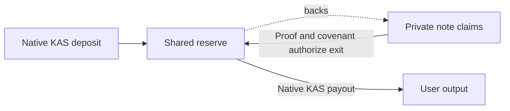

> [PROVENANCE.json](PROVENANCE.json) records the initial import at commit `53023c6f0997177ea6fd2e4b4f2facf84890b865`. Git tracks this later final-result revision; the [statistical interpretation](statistical/FROZEN-RESULT-INTERPRETATION.md) pins its public sources. See [canonical status and ownership](README.md). Historical commands are documentation, not execution approval.

# KPI research field guide

**Research status, 22 October 2026:** the frozen 512-history test completed at **19:50:21 AEDT**; its final public result and both recounts are accepted. The fixed amount heuristic did not beat price-only guessing. Privacy remains unqualified.

Six ideas describe different obligations:

- **Reserve backing:** actual native KAS in the shared reserve must cover outstanding user claims, including unpaid exits. Private notes are claims against that reserve, not a separate token or an operator's promise to release funds.
- **Private notes:** commitments represent spendable claims; encrypted receipts let intended recipients discover their notes. Hiding note contents does not automatically hide relationships, timing or publicly paid amounts.
- **Proof validity:** a proof establishes the circuit's particular ownership and conservation rules. The covenant must also bind the real transaction and successor state. A valid proof does not establish anonymity or correct recipient delivery merely because ciphertext bytes are bound.
- **Independently executable exits:** a holder should be able to withdraw using their own secrets, available public data, an updated witness, proving resources and fees, without operator permission. This still depends on data availability and chain liveness. A successful bounded demonstration is not general recovery assurance.
- **Public observation:** outsiders see transaction structure, ordering, reserve and payout values, scripts, commitments, nullifiers and published authorization data. Encryption does not erase this surface. A reserve movement need not reveal the amount of an internal payment.
- **Colluder information:** participants also know their own payments, receipts and related records. Combining those records can remove ambiguities. The study's “C+D” view already includes an initial funding-owner directory, so it is not chain data alone.

**Read evidence at its actual level.** Imported documents and tracked sources are linked below. Historical `P/` references identify the research checkout; `W/` references identify the original public-development workspace. The provenance manifest records their original and imported identities.

| Evidence level | What it supports—and its limit | Provenance |
|---|---|---|
| Model | Arithmetic, simulated workloads and a declared attacker; no genuine cryptographic or native execution | `P/poc/shared-pool/PRICE-LEAKAGE-SPEC.md` |
| Historical native bytes | Partial extraction of observable fields; absent metadata stays absent. Parsing does not verify proofs, covenant execution or chain acceptance | [W/workers/statistical-review-source-001/NATIVE-OBSERVATION-STATIC-REVIEW.md](statistical/NATIVE-OBSERVATION-STATIC-REVIEW.md) |
| Genuine proof | The pinned relation was proved and checked; this does not measure privacy | [P/poc/shared-pool/TWO-INPUT.md](../../../poc/shared-pool/TWO-INPUT.md) |
| Historical TN10 | Specific testnet admissions, payments and exits worked in bounded traces; not production or general recovery qualification | [P/poc/shared-pool/TWO-INPUT-TN10.md](../../../poc/shared-pool/TWO-INPUT-TN10.md) |

**What earlier failures taught us.** Historical address reuse exposed direct links; key separation removed that tested equality, not all possible links. Short-delay and partial-withdrawal policies failed their privacy gates. Later diagnosis found that successful amount guesses often used unrelated payout supports: correct guesses did not establish reconstructed money paths. Those guesses still count as successes. Removing one public monetary field also leaves redundant arithmetic disclosures; hiding a column is not a protocol change. These lessons favor identifying the information responsible before choosing another mitigation. Sources: [P/poc/shared-pool/ADDRESS-KEY-SEPARATION.md](../../../poc/shared-pool/ADDRESS-KEY-SEPARATION.md), `WORKING-BALANCE-SPARSE-DIAGNOSIS.md`; Forge [kpi-orchestration/2026-10-22/architecture-options/PUBLIC-FIELD-SPEC-REVIEW.md](architecture/PUBLIC-FIELD-SPEC-REVIEW.md).

**What the frozen test found.** Across 512 independent synthetic histories through full drainage, preselected `split_tail` guessed amounts **within 10%** at equal-ledger mean rates of **13.53% C+D**, **14.47% pooled**, versus **20.88% price-only**. There were 18,192 eligible honest-to-honest payments among 32,768 observable targets; histories, not individual targets, receive equal weight. Mean differences were −7.35 percentage points (C+D minus price), −6.41 (pooled minus price), and +0.94 (pooled minus C+D). All three below-five-point tests crossed the frozen threshold of 180; no positive-advantage or above-five-point test crossed. The supported inference is below-five-point advantage for this fixed heuristic in each contrast, not zero leakage or harmless collusion. These are approximate guesses, not exact amount recovery or reconstructed money paths. See the [final interpretation and public evidence identities](statistical/FROZEN-RESULT-INTERPRETATION.md).

The price-only baseline's expected success is about **21.1%**; its observed equal-ledger mean was **20.88%**. Both exceed the unchanged **20% absolute cap**: `qualification_pass=false`. This result does not rehabilitate the rejected policy. A stronger observer could retain the price-only guess. The test does not bound stronger attacks, identify a causal field, or establish native-byte privacy, cryptographic security or real-user anonymity.

**Prepared code is not GPU readiness.** The proposed kernel accelerates observer eligibility checks, not proof generation. Earlier Mac C+D predictions matched; pooled checking stopped at its resource guard. GPU runtime qualification is authorized, with results pending. Complete two-view parity, bounded resource use and whole-process cold/warm benefit still need qualification; kernel timing alone cannot establish useful acceleration or readiness. Sources: [current source-reviewed v3 preparation](compute/gpu-v3/BENCHMARK.md); [historical Mac reference check](statistical/MAC-REFERENCE-PROFILE-REVIEW.md).

**Remaining decisions:** retain the final result and its limits; further attack or calibration work requires a separate decision. The recovery build is authorized, but no recovery runtime proof outcome exists. Preserve backing, recoverability and independent exits when assessing changes. The flat-batching toy demonstrated conditional witness reconstruction and ambiguity, not privacy or deployable proof. Real integration needs a new circuit, covenant and pool. Heavy batching remains deferred until a concrete supported outer-proof implementation is selected; the current prover is not a drop-in aggregator. Source: [batching feasibility review](architecture/BATCHING-NATIVE-FEASIBILITY-REVIEW.md).
