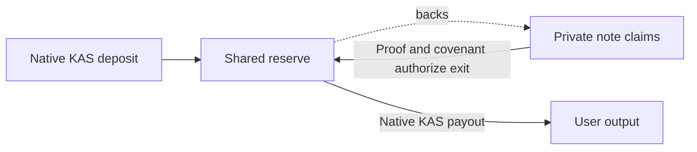

> Imported documentation snapshot. [Canonical status and ownership](README.md). Original artifact hashes inside this document refer to its source artifacts; [PROVENANCE.json](PROVENANCE.json) records the imported bytes. Commands and paths retained from experiments are historical documentation, not execution approval or a runnable package here.

# KPI research field guide

**Research status, 22 October 2026:** the frozen 512-history test was pending at **19:22 AEDT**. This guide uses no interim outcomes. The project has historical evidence for specific native-KAS mechanics; privacy remains unqualified.

Six ideas describe different obligations:

- **Reserve backing:** actual native KAS in the shared reserve must cover outstanding user claims, including unpaid exits. Private notes are claims against that reserve, not a separate token or an operator's promise to release funds.
- **Private notes:** commitments represent spendable claims; encrypted receipts let intended recipients discover their notes. Hiding note contents does not automatically hide relationships, timing or publicly paid amounts.
- **Proof validity:** a proof establishes the circuit's particular ownership and conservation rules. The covenant must also bind the real transaction and successor state. A valid proof does not establish anonymity or correct recipient delivery merely because ciphertext bytes are bound.
- **Independently executable exits:** a holder should be able to withdraw using their own secrets, available public data, an updated witness, proving resources and fees, without operator permission. This still depends on data availability and chain liveness. A successful bounded demonstration is not general recovery assurance.
- **Public observation:** outsiders see transaction structure, ordering, reserve and payout values, scripts, commitments, nullifiers and published authorization data. Encryption does not erase this surface. A reserve movement need not reveal the amount of an internal payment.
- **Colluder information:** participants also know their own payments, receipts and related records. Combining those records can remove ambiguities. The study's “C+D” view already includes an initial funding-owner directory, so it is not chain data alone.

**Read evidence at its actual level.** Imported documents and tracked sources are linked below. Historical `P/` references identify the research checkout; `W/` references identify the original public-development workspace. The provenance manifest records their original and imported identities.

| Evidence level | What it supports—and its limit | Provenance |
|---|---|---|
| Model | Arithmetic, simulated workloads and a declared attacker; no genuine cryptographic or native execution | `P/poc/shared-pool/PRICE-LEAKAGE-SPEC.md` |
| Historical native bytes | Partial extraction of observable fields; absent metadata stays absent. Parsing does not verify proofs, covenant execution or chain acceptance | [W/workers/statistical-review-source-001/NATIVE-OBSERVATION-STATIC-REVIEW.md](statistical/NATIVE-OBSERVATION-STATIC-REVIEW.md) |
| Genuine proof | The pinned relation was proved and checked; this does not measure privacy | [P/poc/shared-pool/TWO-INPUT.md](../../../poc/shared-pool/TWO-INPUT.md) |
| Historical TN10 | Specific testnet admissions, payments and exits worked in bounded traces; not production or general recovery qualification | [P/poc/shared-pool/TWO-INPUT-TN10.md](../../../poc/shared-pool/TWO-INPUT-TN10.md) |

**What earlier failures taught us.** Historical address reuse exposed direct links; key separation removed that tested equality, not all possible links. Short-delay and partial-withdrawal policies failed their privacy gates. Later diagnosis found that successful amount guesses often used unrelated payout supports: correct guesses did not establish reconstructed money paths. Those guesses still count as successes. Removing one public monetary field also leaves redundant arithmetic disclosures; hiding a column is not a protocol change. These lessons favor identifying the information responsible before choosing another mitigation. Sources: [P/poc/shared-pool/ADDRESS-KEY-SEPARATION.md](../../../poc/shared-pool/ADDRESS-KEY-SEPARATION.md), `WORKING-BALANCE-SPARSE-DIAGNOSIS.md`; Forge [kpi-orchestration/2026-10-22/architecture-options/PUBLIC-FIELD-SPEC-REVIEW.md](architecture/PUBLIC-FIELD-SPEC-REVIEW.md).

**What the frozen test answers.** Across exactly 512 independent synthetic histories, it tests the previously selected `split_tail` amount heuristic through full drainage: C+D versus known-price guessing, pooled participant knowledge versus that baseline, and pooled versus C+D. Nine fixed tests distinguish positive advantage from the five-percentage-point question. Predictions must seal before scoring; an independent recount follows. An unresolved result does not mean no leakage. Even a favorable result covers this attack and workload, not stronger attackers, individual-field causation, native-byte privacy or real-user behavior.

The known-price baseline already succeeds about **21.1%** within ten percent of the amount, exceeding the unchanged **20% absolute cap**. The new comparison measures additional predictive information; it does **not** waive that cap or rehabilitate the rejected policy.

**Prepared code is not GPU readiness.** The proposed kernel accelerates observer eligibility checks, not proof generation. A Mac reference check reproduced C+D predictions; pooled checking stopped at its resource guard. CUDA compatibility, complete two-view parity, bounded allocations and cleanup, and whole-process cold/warm benefit still need qualification. Fast kernel timing alone cannot establish useful acceleration. Sources: current source-reviewed preparation at Forge [/home/luke/projects/kpi-orchestration/2026-10-22/compute-plan/revisions/v3/BENCHMARK.md](compute/gpu-v3/BENCHMARK.md); [W/workers/statistical-review-reference-001/MAC-REFERENCE-PROFILE-REVIEW.md](statistical/MAC-REFERENCE-PROFILE-REVIEW.md).

**Remaining decisions:** finish and independently verify the frozen study, then let its scoped contrasts guide the next information question. Preserve backing, recoverability and independent exits when assessing changes. The flat-batching toy demonstrated conditional witness reconstruction and ambiguity; it supplies no privacy guarantee or deployable proof. Real integration needs a new circuit, covenant and pool. Heavy batching remains deferred until a concrete supported outer-proof implementation is selected; the current prover is not a drop-in aggregator. Source: [W/native-surface-review/BATCHING-NATIVE-FEASIBILITY-REVIEW.md](architecture/BATCHING-NATIVE-FEASIBILITY-REVIEW.md).
